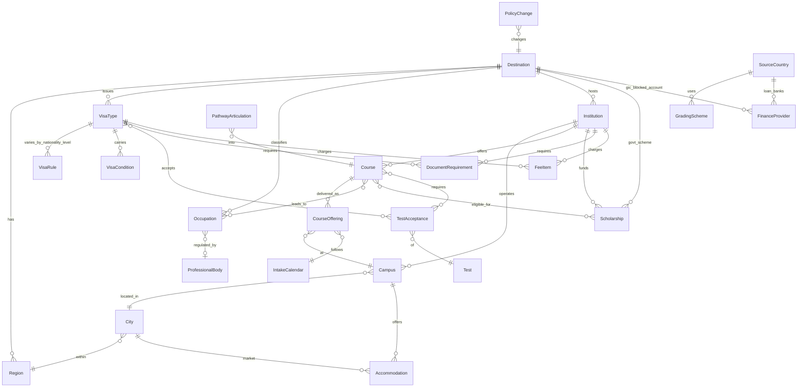

# 01 — Entity model

Every attribute in `03-catalog/` belongs to exactly one entity. Entities are chosen so that
facts which vary independently live on separate records, and so that the variant axes
(nationality, level, offering, intake, region) are explicit keys rather than prose.

## Entities

| Entity | Key | What lives here |
|---|---|---|
| **Destination** | ISO-2 country | Student-visa regime, work rights, post-study visa, insurance scheme, tax IDs, caps policy, degree recognition, FX |
| **Destination×Nationality** | country + origin ISO-2 | Financial-proof amounts and evidence level, SDS/PAL variants, grant rates, TB test, panel clinics, VAC locations, document variants, interview likelihood |
| **Destination×Level** | country + level | PSW length, dependants allowed, work hours, genuine-intent weight, cap exemptions |
| **Region** | country + state/province | Dependant school fees, regional category, state/provincial nomination, minimum-wage bands, provincial health cover |
| **SourceCountry** | ISO-2 origin | Grading schemes, qualification equivalence, MoE NOC rules, FX/remittance rules, education-loan banks, transit visas, panel clinics |
| **GradingScheme** | origin + board/university | Scale, pass and distinction marks, conversion tables to each destination scale with authority |
| **Institution** | `kb_partners.slug` | Type, registration codes, rankings, groups, teaching scores, policies (fees, deposit, refund, deferral), services, risk level, partner status |
| **Campus** | institution + campus slug | City, postcode, regional flag, geo, transport, facilities, housing, security |
| **City** | country + city slug | Living-cost breakdown, safety, climate, population, part-time job market, diaspora, religious facilities, remittance |
| **Course** | `kb_programs._id` | Academic record: level, framework, discipline, credits, accreditation, entry rules, English rules, placement, status |
| **CourseOffering** | course + campus + intake + delivery | Tuition variant, deadlines, seat status, term dates, regional discount. Replaces today's `campuses: string[]` |
| **IntakeCalendar** | institution or offering + term | Dated events: application open/close, orientation, census, exams, breaks, shutdowns, graduation |
| **Occupation** | country + code | Title, skill level, temporal list membership, assessing body, demand, salary, state nomination, licensing |
| **CourseOccupation** | course + occupation | Typical-occupation mapping; the bridge from a course to migration outcomes |
| **ProfessionalBody** | country + profession | Regulator, registration steps, exam, English standard, bridging, source-qualification recognition |
| **Scholarship** | provider + slug | Coverage, eligibility (level, discipline, nationality, campus, intake), deadlines, competitiveness, conditions |
| **Test** | test code | Scale, sections, validity, fee by origin, centres, result days, retake rules |
| **TestAcceptance** | test + (institution or visa) | Accepted for admission / visa, minimums, variant flags (home edition, online, one-skill retake) |
| **VisaType** | country + subclass | Student, dependant, guardian, graduate, work and visitor visas: fee, length rule, conditions |
| **VisaRule** | visa + nationality + level | The requirement values that vary by axis: funds formula, documents, English, interview |
| **VisaCondition** | country + condition code | Plain-English meaning of 8105 / 8202 / 8501 / F-1 status rules etc. |
| **PathwayArticulation** | from qualification → to course | Credit granted, entry year, guaranteed progression, provider, packaging, cost and time delta |
| **DocumentRequirement** | (institution or visa) + level + nationality + stage | Document type, when required, format and attestation rules |
| **FeeItem** | (institution or visa) + item | Any non-tuition fee: application, deposit, SSAF, OSHC, IHS, SEVIS, visa, biometrics, medical, VAC |
| **FinanceProvider** | provider | GIC banks, blocked-account providers, education-loan banks with product terms |
| **Accommodation** | campus or city + type | On-campus, PBSA, homestay, shared, family: cost, bond, lease, guarantee |
| **PolicyChange** | id | Announcement vs effective date, applies-to, transitional rules, source, affected attributes |
| **Agency** | singleton | Expert Education public facts: services, fees, branches, test-prep classes, events, pre-departure |
| **Provenance** | attached to every value | Source, extraction, verification, validity window, confidence, conflicts, change history |

Reserved names, out of scope for this catalog: `Student`, `Application`, `PartnerAgreement`,
`CaseOutcome`, `CounsellorNote`.

## Relationships

## Variant axes

A single attribute can legitimately have several values at once. The axes are:

| Axis | Values | Typical attributes |
|---|---|---|
| `nationality` | origin ISO-2 | financial-proof amount, evidence level, TB test, grant rate, document list, entry requirement by board, MOI acceptance |
| `level` | school, foundation, cert_iii_iv, diploma, adv_diploma, bachelor, honours, grad_cert, grad_dip, pg_dip, masters_coursework, masters_research, masters_extended, phd, top_up, pathway_english | PSW length, dependants, work hours, attendance rule, entry minimums, deadlines |
| `offering` | campus × delivery mode | tuition, intakes, regional flag, seat status |
| `intake` | term identifier | deadlines, census, orientation, intake status |
| `region` | state / province | school fees, nomination, minimum wage, health cover |
| `applicant_type` | international / domestic / onshore / offshore / sponsored | fees, deadlines, deposit |
| `provider` | insurer / bank / pathway provider | insurance price, GIC fee, ELICOS fee |

Storage keys a value by the axes named in the row's `variant_axes`; the answer layer picks
the value matching the student's situation and says which variant it used.

## Keys and identifiers

| Entity | Natural identifiers to store |
|---|---|
| Institution | CRICOS provider code (AU), DLI number (CA), UKPRN and UKVI sponsor name (GB), SEVIS school code (US), NZQA provider code (NZ), MQA code (MY), anabin ID (DE), CAO/HEA code (IE), KHDA/CAA code (AE), MHESI code (TH) |
| Course | CRICOS course code, UCAS code, CIP code, institution course code, NZQA qualification code, Ontario program code |
| Occupation | ANZSCO 6-digit, NOC 2021 5-digit, UK SOC 2020 4-digit, US SOC, ISCO-08 crosswalk |
| Test | see `03-catalog/english-and-tests.md` test catalog |
| SourceCountry qualification | NEB, CBSE, ISC, state boards, HSC (BD), MOET (VN), DepEd K-12 (PH), TU / PU / KU / Pokhara, CTEVT, UGC-recognised (BD) |

## Mapping to today's storage

| Entity | Today | Notes |
|---|---|---|
| Course | `kb_programs` (`ProgramRecord`, `src/ingest/programs.ts`) | ~15 fields; campuses are strings; no offering split |
| Institution | `kb_partners` (`PartnerRecord`, `src/partners/registry.ts`) | Crawl plumbing only: slug, name, aliases, country, website, domains, paths |
| Uploads | `kb_documents` + GridFS `kb_files` | Staff documents; may carry program extraction |
| Everything else | not stored; `web_search` / `fetch_page` against `WEB_FETCH_ALLOWED_DOMAINS`, 6 h `live_cache` | No Destination, Campus, City, Occupation, Scholarship, Test, Visa, Pathway, Grading, Intake, PolicyChange entity |
